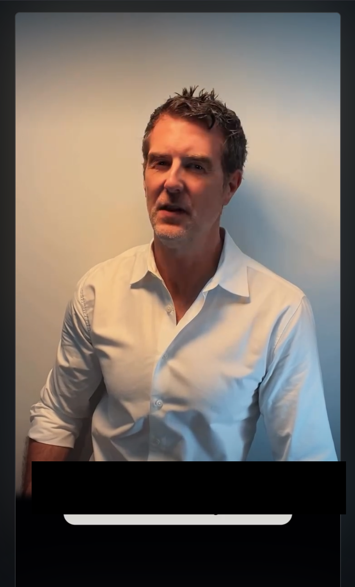
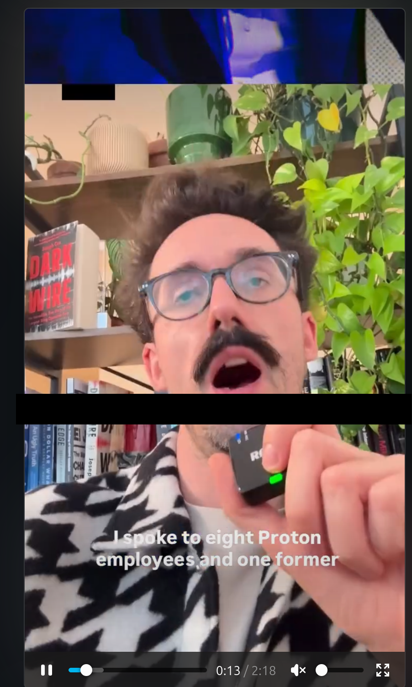
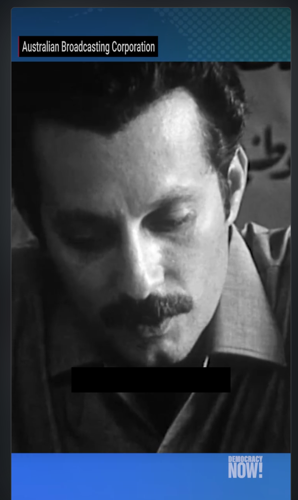
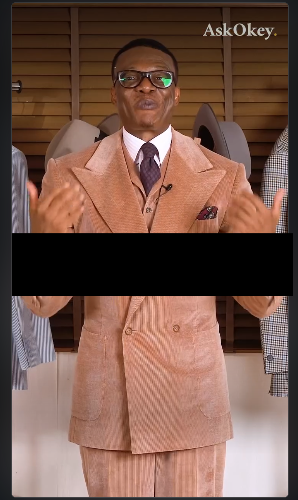
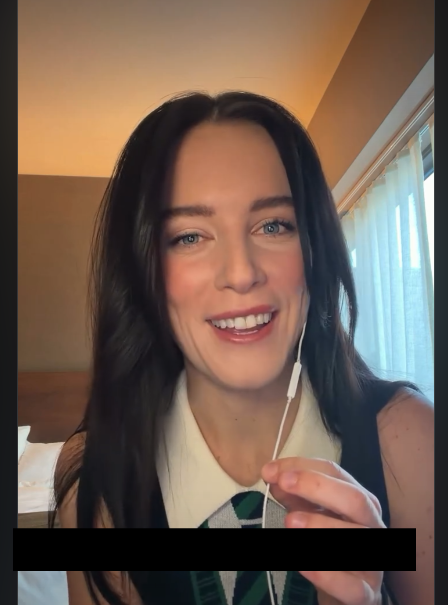
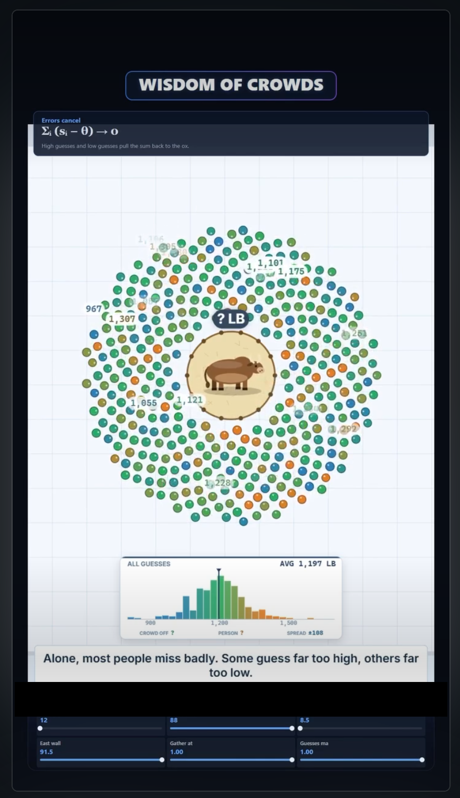

# README

Not yet published within Firefox's Add-ons repository. This is a beta under development.

0.1 - project skeleton and initial testing

0.2 - improved multi-area zones. Active scanning. Background text avoidance.

0.3 - detects narrow vertically stacked text near video edges, based on a 50-video feed sample.

# Instagram-text-blocker

Places a black bar over the top of the wretched text overlays on Instagram.

A minimal, open-source Firefox extension for Linux that masks burned-in words or subtitles on Instagram Reels. Everything runs locally in the browser. There are no analytics, network requests, cloud APIs, or Google services.

## How it works

When a playing Reel becomes visible, the extension waits three seconds while sampling scaled-down video frames. It looks for persistent, high-contrast horizontal regions typical of speech captions, top headlines, and centre banners, plus constrained vertical text near either edge. It then leaves up to three black masks in place until the visible Reel changes. The delay, padding, and maximum number of bars are configurable.

The detector does not use OCR. It neither reads nor stores the words. Avoiding OCR keeps the extension small, fast, and private.

## What it looks like






## Where it fails


## Install temporarily (development)

1. Open `about:debugging` in Firefox.
2. Choose **This Firefox**.
3. Choose **Load Temporary Add-on…** and select `manifest.json` in this directory.
4. Open Instagram and play a Reel.

Temporary extensions disappear when Firefox restarts.

This is only temporary until I get the XPI signed by Firefox. Soon enough!

## Controls

- `Alt+Shift+B`: toggle masking.
- `Alt+Shift+M`: create/edit a manual mask. Drag the bar and resize it from its lower-right corner; press the shortcut again to lock it.
- The toolbar popup exposes both actions and the settings page.
- Settings: analysis delay (default 3 seconds), padding (default 12 px), maximum automatic bars (default 3), and enabled state.

Firefox shortcuts can be changed at **Add-ons and themes → Extensions → Manage Extension Shortcuts**.

## Frame-capture and cross-origin restrictions

The extension uses `canvas.drawImage(video, …)` followed by `getImageData()`. Drawing a cross-origin video is possible, but reading its pixels is forbidden unless the media is *origin-clean*. A forbidden read throws a `SecurityError`; the extension catches that and offers manual placement.

Instagram commonly feeds video elements from same-origin `blob:`/MediaSource URLs, which may be readable, but this is an implementation detail Instagram or Firefox can change. The included runtime probe is the only reliable test for a particular Reel. Host permissions do not bypass the browser's canvas origin protections.

`captureVisibleTab` was deliberately not used: Firefox ties it to user activation/permissions and it would capture the page UI as well as the video, making continuous automatic analysis intrusive and brittle.

**Testing:** To test on a real Reel, load the extension temporarily, open Firefox developer tools, play a Reel, and watch for either a mask or the explicit origin-blocked notice. This cannot be fully validated in an offline unit test because it depends on Instagram's current media delivery and the signed-in Firefox session.

## Limitations

- Detection is heuristic. Logos, busy graphics, or strong horizontal detail can be mistaken for subtitles; low-contrast or unusually placed text can be missed.
- Up to three rectangular bars are used. Free-moving words, central vertical text, or more than three separated regions may need the manual fallback.
- The mask follows the active video element but not every transient layout animation. Scrolling to the next Reel resets analysis and the mask.
- Instagram DOM and media-delivery changes can break detection.
- The extension masks pixels on screen; it does not remove text from the underlying video.
- Manual position is intentionally per-Reel and is not uploaded or persisted.

## Tests

Requires Node.js 18 or newer:

```sh
npm test
npm run lint
```

The tests cover blank frames, delayed captions, multiple simultaneous text regions, mask limits, edge-aligned vertical text, and central-object rejection. Real-site capture must be tested interactively because of authentication, media URLs, and browser security policy.

## Privacy and licence

No captured frame leaves memory or is written to disk. The extension requests only Instagram host access and local extension storage.

ZERO data is captured as telemetry and absolutely ZERO information is sent anywhere for any reason.

Released under the [MIT License](LICENSE).
